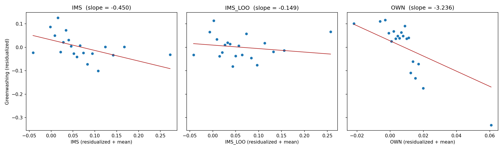

# IMS_LOO 基准回归不显著的诊断报告

## 结论摘要

IMS_LOO 不显著，**不是因为统计功效下降，而是因为点估计本身大幅缩小**：系数从 −0.483 降到 −0.149（修正审计师编码后为 −0.179），而标准误基本不变（约 0.24）。两者之差 −0.30 在 1% 水平上显著（p = 0.001），因此这是真实的系数差异，不是抽样噪声。

差异的来源是 IMS 里的"焦点公司自身成分"：

- IMS = IMS_LOO + OWN，其中 OWN 是焦点公司自己的营业收入对其审计师行业市场份额的贡献。OWN 只占 IMS 残差方差的约 10%，却贡献了 IMS 与漂绿协方差的 **69%**。
- OWN 与焦点公司在行业—年份内的营收份额（SHARE）的相关系数为 0.99。也就是说，基准回归中的负向关系主要反映的是**"行业龙头公司漂绿更少"**，而不是"聘请了行业专长审计师的公司漂绿更少"。
- 控制 SHARE 之后，原始 IMS 的系数降到 −0.109（p = 0.66）；剔除 SHARE 最高的 5% 观测后，原始 IMS 本身也不再显著（−0.248，p = 0.34）。
- 二元指标的情况相同：IMS_D 的效应完全来自 214 个"只是因为自己营收大才让审计师达到 20% 门槛"的观测（系数 −0.394，p = 0.008）；剔除自身营收后仍达到门槛的"真正专长审计师"客户（647 个），系数只有 −0.044（p = 0.61）。

另外发现 LOO 构造脚本存在一个审计师编码不一致的问题，导致 103 个观测被错误丢弃。修正后样本恢复到 15,380，但 IMS_LOO 仍不显著，因此它不是不显著的主因。

---

## 1. 问题描述

| 设定 | 系数 | 标准误 | p 值 | N |
|---|---|---|---|---|
| IMS（基准，全样本） | −0.4829 | 0.2362 | 0.041 | 15,381 |
| IMS_D（基准，全样本） | −0.1434 | 0.0794 | 0.071 | 15,381 |
| IMS_LOO（当前脚本） | −0.1489 | 0.2406 | 0.536 | 15,277 |
| IMS_LOO_D（当前脚本） | −0.0256 | 0.0855 | 0.764 | 15,277 |

所有回归的设定与基准回归完全一致：因变量为 `Greenwashing连续_基准`，14 个控制变量，行业与年份固定效应，按公司聚类标准误。

诊断脚本为 `diagnose_loo_insignificance.py`，所有输出位于 `outputs/diagnostics/insignificance/` 与 `outputs/figures/`。

---

## 2. 逐项排除的解释

### 2.1 不是原始 IMS 构造有误

用全市场文件按原 X 复现口径重新计算 IMS（`IMS_FULL`），在 LOO 有效样本上与面板中的 IMS **100% 逐行一致**（误差 < 1e-9），回归结果也完全相同（A5 = A3）。

注：现有的 `outputs/diagnostics/ims_construction_audit.csv` 报告的相关系数 0.898 是拿 IMS 与"仅用回归样本计算的市场份额"做比较，口径本来就不同，不能说明 IMS 构造有问题。

### 2.2 不是样本损失（但发现了一个编码问题）

当前 LOO 样本比基准少 104 个观测。拆开看：

- **103 个观测**：面板中的 `InstitutionID` 是境外或次要审计机构（例如 PwC Accountants N.V、KPMG Accountants N.V、Ernst & Young LLP、Ebner Stolz、各类香港所），而全市场文件里同一公司—年度记录的是境内主审事务所。原始 IMS 当时用的是**全市场文件的主审编码**（103 个观测 100% 吻合），但 `run_loo_analysis.py` 用的是面板的编码，因此在全市场中找不到对应的审计师—行业—年份单元格，这些观测被丢弃。
- **1 个观测**：营业收入为负，不参与全市场加总。

这 103 个观测的漂绿均值为 −1.125（其余观测为 0.006），IMS 均值 0.113，IMS_D 均值 19%，因此它们对系数的影响不小：只丢掉它们，就能让 IMS 的系数从 −0.483 变为 −0.450，p 值从 0.041 升到 0.058。

改用全市场主审编码重建 LOO（`IMS_LOO_MK`）后：

| 设定 | 系数 | 标准误 | p 值 | N |
|---|---|---|---|---|
| IMS（同样本） | −0.4831 | 0.2362 | 0.041 | 15,380 |
| IMS_LOO_MK | −0.1790 | 0.2395 | 0.455 | 15,380 |
| IMS_LOO_MK_D | −0.0426 | 0.0847 | 0.615 | 15,380 |

在两个版本都有效的观测上，`IMS_LOO_MK` 与原 `IMS_LOO` 完全相同。修正编码能找回样本，但 IMS_LOO 依然不显著。

### 2.3 不是统计功效下降

IMS_LOO 与 IMS 的标准误几乎相同（0.2406 vs 0.2376），残差化后两者的相关系数为 0.95，IMS_LOO 保留了 IMS 约 93% 的残差方差。问题出在点估计缩小了约 2/3。

把两个回归堆叠起来、按公司聚类，检验 \(\beta_{IMS} = \beta_{IMS\_LOO}\)：

| 比较 | 差值 | 标准误 | p 值 |
|---|---|---|---|
| IMS vs IMS_LOO（N=15,277） | −0.301 | 0.096 | 0.002 |
| IMS vs IMS_LOO_MK（N=15,380） | −0.304 | 0.095 | 0.001 |
| IMS_D vs IMS_LOO_D | −0.104 | 0.047 | 0.025 |
| IMS_D vs IMS_LOO_MK_D | −0.101 | 0.046 | 0.028 |

由于两个估计量高度相关（相关系数约 0.92），它们的差值估计得很精确。结论是：剔除焦点公司后，系数**确实**变了，不能用"LOO 的置信区间也覆盖 −0.48"来解释。

### 2.4 不是单一客户单元格造成的

有 1,257 个观测（8.2%）是其审计师在该行业—年份内的唯一客户，剔除自身后 IMS_LOO 恰好等于 0。它们看起来是可疑来源，但检验结果否定了这一点：

- 这些观测只贡献了 IMS 与漂绿协方差的 2.3%；
- 剔除它们后，IMS 的系数为 −0.497，IMS_LOO 为 −0.116，差距依旧（C1、C2）；
- 在 IMS_LOO 回归中加入单一客户虚拟变量，结果也几乎不变（B7）。

---

## 3. 真正的原因：IMS 中的焦点公司自身成分

### 3.1 分解

设焦点公司营收为 \(R\)，其审计师在该行业—年份的客户总营收为 \(A\)，行业—年份总营收为 \(T\)，则

\[
IMS = \frac{A}{T},\qquad IMS\_LOO = \frac{A-R}{T-R},\qquad OWN = IMS - IMS\_LOO = \frac{R\,(T-A)}{T\,(T-R)} \approx SHARE\times(1-IMS)
\]

其中 \(SHARE = R/T\) 为焦点公司在行业—年份中的营收份额。数据中 OWN 与 SHARE 的相关系数为 0.987，残差化后仍为 0.980。因此 **OWN 基本就是"公司在本行业中的相对规模"**。

### 3.2 协方差分解（Frisch–Waugh–Lovell）

先把漂绿、IMS、IMS_LOO、OWN 都对控制变量和固定效应做残差化。因为 \(res_{IMS} = res_{IMS\_LOO} + res_{OWN}\)，IMS 系数的分子可以精确拆分：

| 项目 | 数值 |
|---|---|
| var(res_IMS) | 0.00516 |
| 其中 var(res_OWN) | 0.00050（约 10%） |
| cov(res_GW, res_IMS) | −0.00232 |
| 其中来自 IMS_LOO | −0.00071（31%） |
| 其中来自 OWN | −0.00161（**69%**） |

OWN 只占 IMS 变动的一小部分，却承担了 IMS 与漂绿之间大部分的负相关。剔除它之后，剩下的"审计师来自其他客户的行业份额"与漂绿的关联很弱。



分箱散点图（20 个等分位箱，均为残差化后的数值）显示：IMS 的负斜率在 IMS_LOO 中基本消失，而 OWN 的负斜率非常陡，且主要由右端 OWN 较大的几个箱驱动。

### 3.3 回归证据

| 设定 | 变量 | 系数 | 标准误 | p 值 |
|---|---|---|---|---|
| B1 仅 OWN | OWN | −3.236 | 1.100 | 0.003 |
| B2 IMS_LOO + OWN | IMS_LOO | −0.195 | 0.242 | 0.419 |
| | OWN | −3.263 | 1.101 | 0.003 |
| B3 仅 SHARE | SHARE | −3.130 | 0.998 | 0.002 |
| B4 IMS + SHARE | IMS | −0.109 | 0.250 | 0.662 |
| | SHARE | −3.022 | 1.037 | 0.004 |
| B6 IMS + Size² | IMS | −0.315 | 0.240 | 0.190 |
| B8 SHARE + Size² | SHARE | −2.263 | 0.945 | 0.017 |
| B9 IMS_LOO + SHARE + Size² | IMS_LOO | −0.090 | 0.246 | 0.714 |

要点：

1. 只要控制了公司的行业营收份额 SHARE，原始 IMS 就不再显著（B4）。
2. SHARE 的效应在控制 Size 与 Size² 之后仍然显著（B8），说明这不只是规模的非线性，而是"在本行业中的相对地位"本身与漂绿负相关。
3. 仅仅加入 Size² 就能让原始 IMS 的 p 值升到 0.19（B6），说明基准结果对规模的函数形式比较敏感。

### 3.4 效应集中在少数行业龙头

按 SHARE 分组的描述性统计：

| SHARE 分位 | N | 漂绿均值 | IMS 均值 | IMS_LOO 均值 | 公司占其审计师行业业务的比例 |
|---|---|---|---|---|---|
| 0–50% | 7,639 | 0.064 | 0.053 | 0.053 | 10% |
| 50–90% | 6,110 | 0.033 | 0.070 | 0.065 | 26% |
| 90–95% | 764 | −0.310 | 0.110 | 0.085 | 46% |
| 95–99% | 611 | −0.403 | 0.149 | 0.085 | 65% |
| 99–100% | 153 | −0.807 | 0.347 | 0.111 | 81% |

SHARE 最高的 5% 公司漂绿明显更低，而它们的 IMS 之所以高，主要是因为它们**自己**就占了审计师在该行业业务的 65%–81%；剔除自身后，它们的 IMS_LOO 与中等公司差不多。

子样本检验与此一致：

| 子样本 | IMS 系数（p） | IMS_LOO 系数（p） | N |
|---|---|---|---|
| 剔除 SHARE 最高 1% | −0.325（0.195） | −0.152（0.547） | 15,124 |
| 剔除 SHARE 最高 5% | −0.248（0.342） | −0.165（0.525） | 14,513 |
| 剔除自身占审计师行业业务 > 50% 的公司 | −0.326（0.217） | −0.232（0.386） | 12,749 |

只剔除 1% 的行业龙头，原始 IMS 就不再显著；剔除 5% 后，IMS 与 IMS_LOO 的系数已经很接近。

### 3.5 二元指标 IMS_D 的情况

| IMS_D | IMS_LOO_D = 0 | IMS_LOO_D = 1 |
|---|---|---|
| 0 | 14,416 | 0 |
| 1 | 214 | 647 |

剔除自身营收后，IMS 只会下降，所以不存在从 0 变为 1 的观测。把 IMS_D = 1 拆成两组放进同一个回归（参照组为 IMS_D = 0）：

| 组别 | N | 系数 | 标准误 | p 值 |
|---|---|---|---|---|
| 剔除自身后仍 ≥ 20%（真正的行业专长审计师） | 647 | −0.044 | 0.087 | 0.611 |
| 仅因自身营收才 ≥ 20% | 214 | −0.394 | 0.148 | 0.008 |

这 214 个观测的画像：漂绿均值 −0.56，SHARE 均值 15%，公司自身占其审计师行业业务的 48%，Size 均值 23.7（样本均值约 22.3），Big4 比例 19.6%。IMS_D 的基准效应完全来自这组"自己撑起审计师行业份额"的大公司。

---

## 4. 补充：漂绿的两个构成项

`Greenwashing连续_基准 = GI_z_行业年度 − ESGE_z_行业年度`（披露的行业—年度 z 值减去环境得分的行业—年度 z 值）。分别回归：

| 因变量 | IMS | IMS_LOO | OWN（与 IMS_LOO 同时放入） |
|---|---|---|---|
| GI_z（披露） | −0.017（p=0.93） | 0.130（p=0.47） | −1.421（p=0.038） |
| ESGE_z（环境表现） | 0.433（p=0.007） | 0.279（p=0.089） | 1.842（p=0.013） |

- OWN（即行业龙头程度）同时带来更高的环境得分和相对更少的绿色披露，两者叠加，使漂绿指标显著下降。这更像是公司规模或行业地位的特征（例如评级机构对大公司的环境评分偏高、龙头公司面临更多监管关注），而非审计师专长的作用。
- IMS_LOO 与环境得分有弱正相关（p=0.089），但它同时与披露呈正相关（不显著），两者在"披露减表现"的差值中相互抵消，这也是 IMS_LOO 对漂绿指标系数接近 0 的原因之一。

---

## 5. 对研究的含义

1. **LOO 检验恰好起到了应有的作用**：它把基准结果中"焦点公司自身规模机械进入解释变量"的部分识别了出来。基准 IMS 的负向关系有约七成来自这一机械成分，而且集中在 SHARE 最高的约 5% 行业龙头。
2. 在目前的数据中，**没有证据表明剔除焦点公司后的审计师行业专长与漂绿有关**：IMS_LOO 在各种设定下均不显著，且 IMS 的效应在控制 SHARE 后消失。
3. 基准结果本身就处于显著性边缘：删掉 103 个编码不一致的观测，p 值就从 0.041 变为 0.058；换成 wild cluster bootstrap 后也只接近 10% 水平（见 `validation/P1/Cluster/response.md`）。再叠加本报告的发现，基准结论比较脆弱。
4. 审稿人要求 LOO 通常正是担心这种机械关联。如果在论文中报告 LOO，建议如实说明 IMS_LOO 不显著的原因，并同时报告"控制 SHARE"的结果，而不是把 LOO 作为支持基准结论的稳健性检验。

---

## 6. 附带发现的代码与输出问题

1. **审计师编码不一致（影响结果）**：`run_loo_analysis.py` 用面板的 `InstitutionID` 去匹配全市场的审计师—行业—年份单元格，但原始 IMS 使用的是全市场文件中的主审编码。建议改为按"证券代码—年度"从全市场文件取主审编码后再构造 LOO（即诊断脚本中的 `IMS_LOO_MK`），样本可恢复到 15,380。
2. **缺失原因标注错误**：营收为负的那 1 个观测，IMS_LOO 为缺失，但在 `missing_reasons.csv` 中被标为 `valid`（因此 valid 为 15,278，而实际非缺失为 15,277）。
3. **过期文件**：`outputs/diagnostics/ims_loo_summary.csv` 的样本量为 18,077，并非当前脚本生成，应是旧版本遗留，建议删除以免误读。
4. **重复文件**：`data/derived/ims_loo_panel.csv` 与 `ims_loo_panel_corrected.csv` 内容相同。
5. **审计口径说明**：`ims_construction_audit.csv` 比较的是"全市场 IMS"与"回归样本内份额"，相关系数 0.898 属于口径差异，不代表构造错误（见 2.1）。

---

## 7. 复现

```powershell
python "validation/P1/LOO/diagnose_loo_insignificance.py"
```

| 输出文件 | 内容 |
|---|---|
| `outputs/diagnostics/insignificance/diagnostic_regressions.csv` | 全部诊断回归（A 组：样本与构造；B 组：分解；C 组：子样本；D 组：二元转换；E 组：漂绿构成项） |
| `outputs/diagnostics/insignificance/coefficient_difference_test.csv` | 堆叠回归的系数差异检验 |
| `outputs/diagnostics/insignificance/fwl_covariance_decomposition.csv` | FWL 方差与协方差分解 |
| `outputs/diagnostics/insignificance/construction_check.csv` | 构造核对、编码不一致、OWN 分布 |
| `outputs/diagnostics/insignificance/group_profiles.csv` | 按单一客户、IMS_D 转换、SHARE 分位分组的画像 |
| `outputs/diagnostics/insignificance/binary_transition_crosstab.csv` | IMS_D × IMS_LOO_D 交叉表 |
| `outputs/figures/binscatter_ims_vs_loo.png` | 分箱散点图 |
