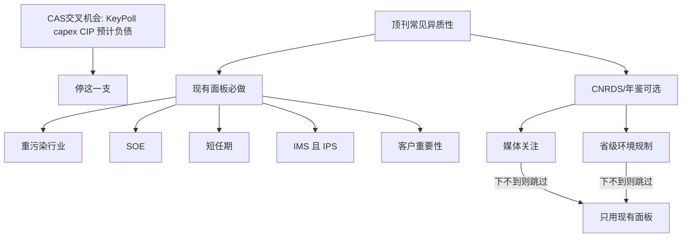

# 文献导向的下一轮异质性（只用现有面板；媒体/规制可选项）

## 现有结果给出的边界

[当前结果备忘.md](d:\Charlie 应用\Documents\zkk\Research Project\greenwashing\validation\P1\mechanism_verifiability\results\当前结果备忘.md)已经预注册式否掉了 CAS 1521「交叉机会」线：

- `IMS × KeyPoll` 约束交互显著，**完全交互后消失**
- capex / 在建工程没有更强负向关联；低 CIP 组甚至更负
- 预计负债方向对、差异不显著
- 唯显著财务交互是 `PPE_TA`，按原计划不得拔高成设备渠道

因此**不再继续渔 capex/CIP/KeyPoll**。下一轮换成顶刊里真正常见的两类调节：审计专长何时更强、漂绿压力/监督何时更高。规格沿用已验证协议：约束交互 + **完全交互（主检验）** + 分组；只写 md，**不改** [Paper.tex](d:\Charlie 应用\Documents\zkk\Research Project\greenwashing\Writting_paper\Paper.tex)。

## 文献里常见的异质性（对标后取舍）

审计专长（TAR/JAR/JAE/AJPT）：

- 国家×城市联合专长质量最高：Reichelt and Wang, *JAR* 2010；定价对应 Francis, Reichelt and Wang, *TAR* 2005
- 短任期时行业专长可替代客户特定知识：Gul, Fung and Jaggi, *JAE* 2009
- 在 Big N 内识别专长、与品牌分开：Balsam, Krishnan and Yang, *AJPT* 2003（中国 Big4 占比低，只作附录）
- 国企对高质量审计需求更弱：Wang, Wong and Xia, *JAE* 2008

漂绿 / 选择性披露：

- 环境损害企业在监督更强时更少选择性披露：Marquis, Toffel and Zhou, *Organization Science* 2016
- 中国市场对漂绿曝光的反应、媒体：Du, *JBE* 2015
- 中国实证几乎必做：**重污染行业、产权、媒体、环境规制**；准则本身也点名高环境风险行业（石油天然气、化工、制药、冶金、采矿、造纸、印染、公用事业等，CAS 1631/现 1521 应用指南）
- ESG 负面报道提高审计投入：Burke, Hoitash and Hoitash, *Accounting Horizons* 2019；Asante-Appiah and Lambert, *RAS* 2023

与上一轮的关键差别：KeyPoll 是**公司自述监管身份**，和规模/控制高度纠缠；重污染是**行业分类**，不随披露选择而变，且行业 FE 仍可保留（被吸收的是行业主效应，`IMS × HeavyPoll` 仍由行业内 IMS 变异识别）。

## 主线（现有 15,381 面板，不另下）

数据：已并好的机制面板 + 基准控制（[reproduce_regression.py](d:\Charlie 应用\Documents\zkk\Research Project\greenwashing\Regression\scripts\reproduce_regression.py)）。`IPS`/`IPS_D` 已在输入面板；`InstitutionID`、`TotalAuditFee` 可构造客户重要性。

五个 V，**平行报告、不同时进一个式子**：

1. `**HeavyPoll**`（优先）
  用现有 `IndustryCode`/`ExpertiseIndustryCode`，按环保部《上市公司环保核查行业分类管理名录》+ 准则点名行业编码。预测：`IMS × HeavyPoll < 0`。这是最接近「准则范围」且尚未做过的检验。
2. `**SOE**`
  已有。中国漂绿与审计质量文献的标准分组。预测常为非国企中专长更强（审计需求更市场化）。
3. `**ShortTenure**`
  `AuditorTenure` 已有；用行业–年中位数或 ≤3 年。对应 Gul et al. (2009)：客户知识不足时专长更重要。
4. **联合专长 `BothSpec = 1{IMS_D=1 且 IPS_D=1}`**
  对应 Reichelt and Wang (2010)。这是处理强度细化，不是新的漂绿机会。报告 `BothSpec` 相对「仅国家/仅分所/都不是」的 IMS 等价比较（或 `IMS × IPS`）。
5. **客户重要性 `CI`**
  客户审计费 / 同一 `InstitutionID`–年全部客户审计费。高 CI 可能损害独立性，预测 `IMS × HighCI` 减弱（更不负）。

每个 V 都走三层完全交互。`IMS` 与 `IMS_D` 都报。Big4 子样本只附录（细胞太小）。

明确不做：再跑 KeyPoll/capex/CIP；把 `PPE_TA` 写成主机制；三阶交互；用 `EnvInvest_D`、ISO、排放打分（循环/披露选择）。

## 先不做，跳过：可选项：媒体关注、地区环境规制（A 股可匹配；下不到就跳过）

南审入口一般是 CNRDS + CSMAR。两套都能按证券代码或省份接到 15,381。

**媒体关注（公司–年，直接匹配代码）**

- **首选**：CNRDS「中国上市公司财经新闻数据库 CFND」→ **报刊财经新闻量化统计**（或网络量化统计）  
键：`股票代码` 六位 + 把日度 `统计日期` 加总到日历年。  
字段：标题/内容新闻总数、全部/原创正中负面条数。  
构造：`Media = ln(1+内容新闻总数)`；稳健性用负面新闻占比。覆盖 1994/2001–2024，与样本重叠。
- 文献对应：Marquis et al. (2016) 的 scrutiny；Burke et al. (2019) 更贴**负面 ESG 报道**。总财经新闻 ≠ 环境新闻。若要环境专用：同一库「基本信息」表用标题/正文筛环保词后年加总——工作量大，不作阻塞。
- 备选：CSMAR 新闻舆情（若校网开通），同样按证券代码–年。

**地区环境规制（省份–年，再接到公司）**

- 公司侧省份：现有 [STK_LISTEDCOINFOANL](d:\Charlie 应用\Documents\zkk\Research Project\greenwashing\appendix\上市公司基本信息年度表094521305(仅供南京审计大学使用)\STK_LISTEDCOINFOANL[DES][csv].txt) **没下省份字段**，需在 CSMAR「上市公司基本信息年度表」补 `所属省份`/`注册地址`（2021–2024），键仍是证券代码 + 年。
- 省份侧：**CNRDS 中国环境统计数据库 ENVS / 中国环境数据库 CEDS**（校网若有），或 EPS/《中国环境统计年鉴》的工业污染治理投资、二氧化硫去除率等，按唐国平等常见做法合成省级 ERI，再按省份–年左连。
- **不要优先用中央环保督察 DID**：首轮 2016–2017 已结束，2021–2024 几乎全省都已督察过，样本内变异弱。PITI 只覆盖约 120 城，匹配不全。

匹配规则：证券代码 6 位；媒体按会计年度加总；规制用注册地省份（不是办公地则表注说明）。缺失：媒体未检索到当 0 并报告非缺失子样本；省份缺失不填，缩小样本。

下不到 CFND/年鉴/省份字段 → **整支可选项取消**，不影响主线五个 V。

## 产出与停手规则

脚本放 `validation/P1/mechanism_verifiability/code/`（新建 `run_lit_hetero.py`，可复用完全交互函数）。结果只写 `results/当前结果备忘.md` 的新节或新文件 `results/文献异质性备忘.md`。

预先写死：

- 完全交互后 `IMS × HeavyPoll` 仍显著为负：可写「负向关联在准则点名的高环境风险行业更强」；仍不是质询证据。
- SOE/任期/联合专长/CI 出结果：按对应文献读，作为**专长何时更强**，不要回流成 CAS 1521 过程。
- 若五个现有面板 V 在完全交互后都不稳健：md 写明「平均 IMS 关联存在，文献标准异质性未找到」——**停止再开异质性支**，不要改正文。

